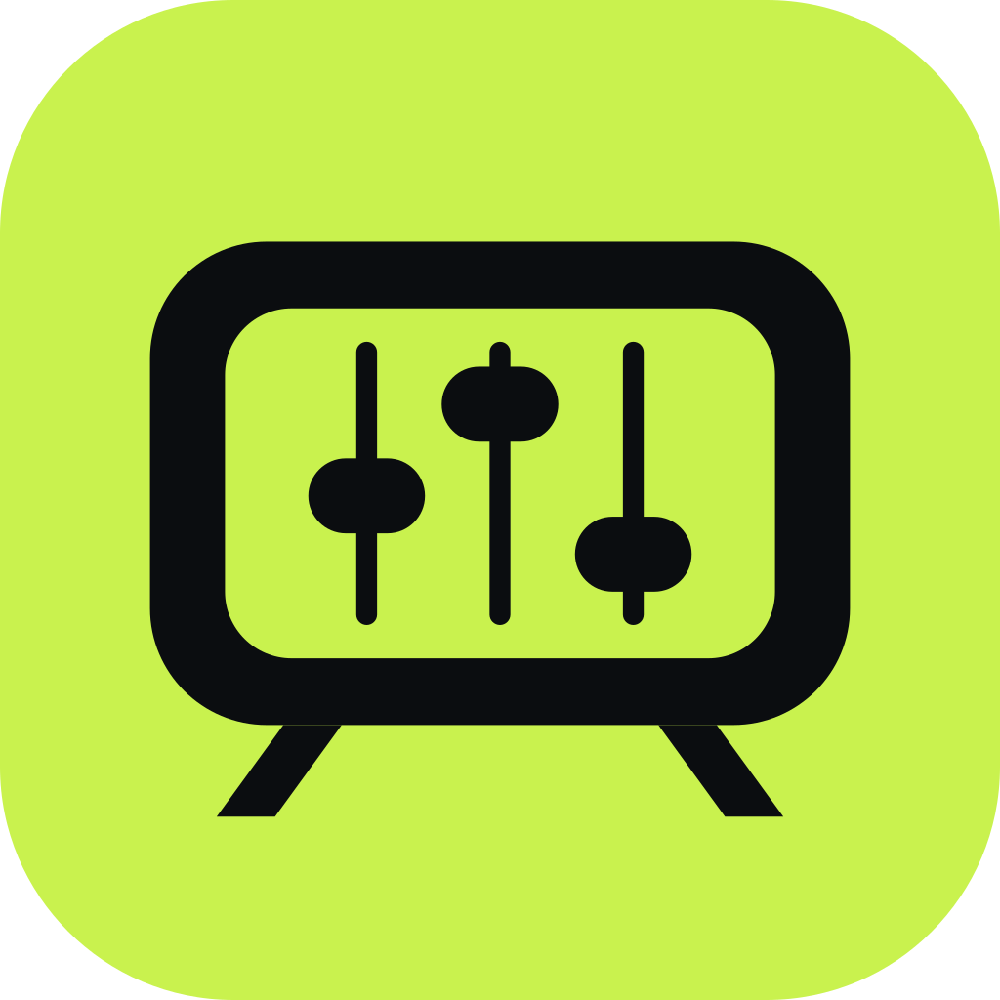
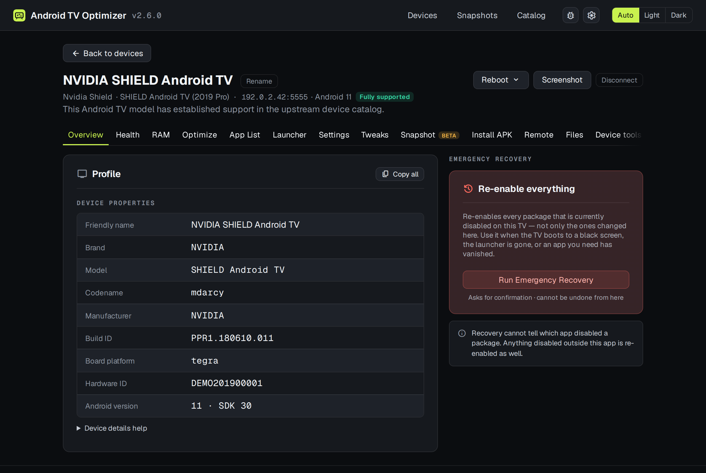
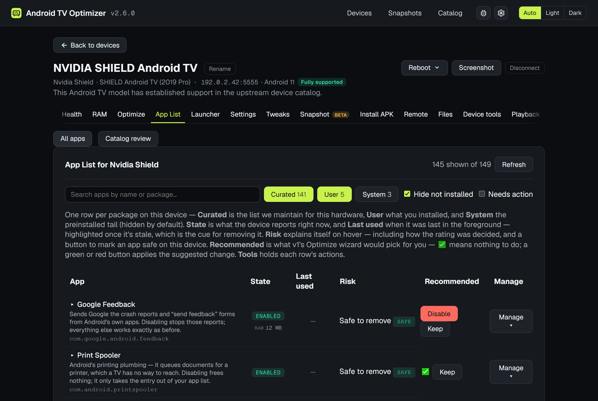
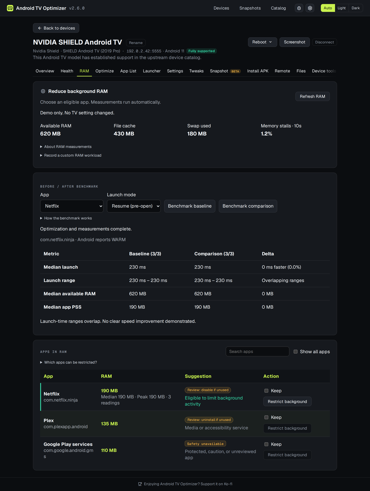
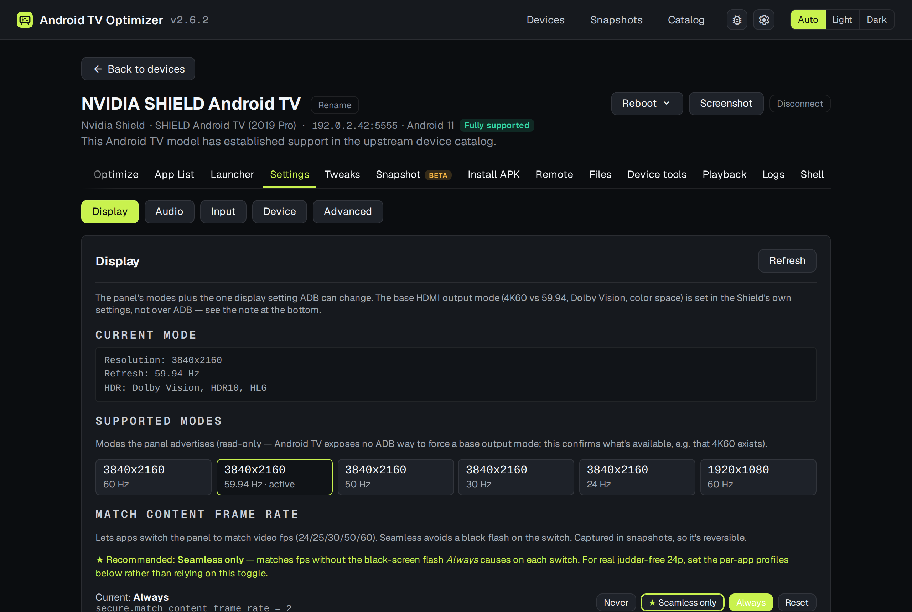
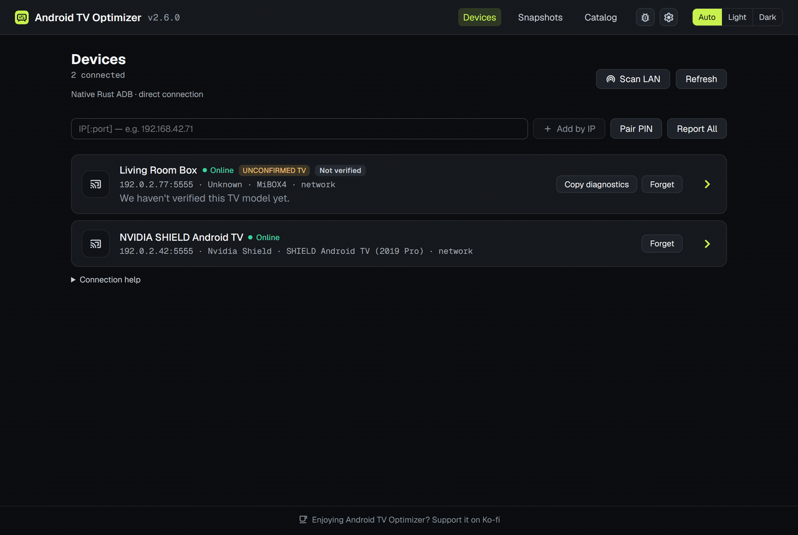
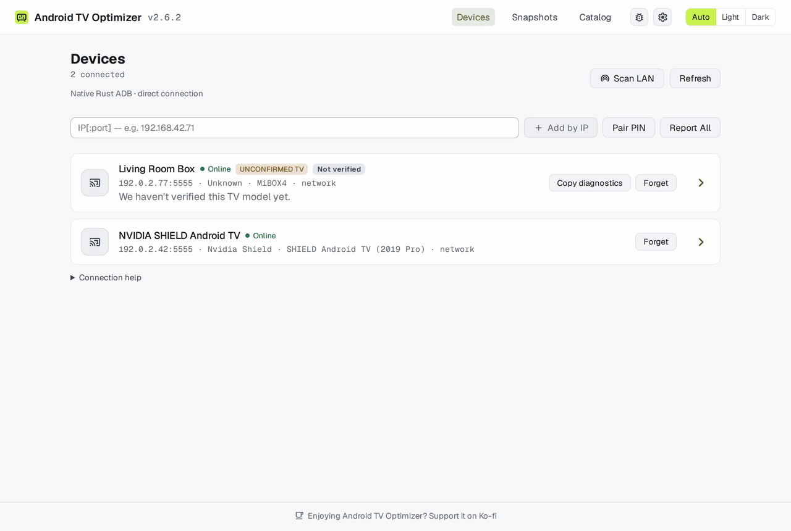

  

# Android TV Optimizer

Manage, debloat and tune Android TV and Google TV from your computer. Browse installed apps, switch launchers, sideload APKs and adjust device settings without a terminal.

This is my desktop fork of [Bryan Roscoe's ATV Optimizer](https://github.com/bryanroscoe/shield_optimizer), previously called Shield Optimizer. I'm building this for Android TV more broadly, including Google TV, onn., Chromecast and NVIDIA Shield. Features still depend on your device's firmware and ADB permissions.

**[Download for Windows, macOS or Linux](https://github.com/LosLonelyDevs/AndroidTV-Optimizer/releases)** · [Report a problem](https://github.com/LosLonelyDevs/AndroidTV-Optimizer/issues) · [Build from source](v2/README.md)

## What I've added

Upstream provides the core device discovery, ADB, safety catalog, debloating and recovery features. My changes build on that:

- **RAM controls with before/after measurements.** RAM refresh starts when you ask and can be stopped. Restrict eligible apps' background activity with saved Undo, or compare three launch trials before and after a change. The results show what changed on your device; they don't promise a speedup.
- **One app table with more control.** Curated and discovered apps share the same view, with usage, RAM, recommendations and maintenance actions. I've added per-app cache/data clearing, per-device risk overrides and usage recommendations that account for uptime. An override cannot bypass the protected-package block.
- **Grouped device settings and remembered devices.** Display, Audio, Input, Device and Advanced controls live together. There are extra display, audio and system controls, plus saved addresses and background-process-limit pins. Saved tweaks require a verified hardware ID; matching an IP address isn't enough.
- **More useful APK management.** Quick install downloads compatible release assets from a curated catalog. The folder manager compares APK versions with installed versions, handles downgrade attempts and includes Shizuku setup. This extends upstream's sideloading and APK inspection.
- **Recording, mirroring and diagnostics.** Record the TV screen, open a separate scrcpy mirror window, inspect storage and larger files, and review actions in the activity console. Recording currently needs the Google platform-tools engine; some tools require a separate download.

I checked these additions against upstream `d62f4a4d` on November 18, 2026. See the [fork review](docs/FORK-REVIEW-2026-11-18.md) for the code and test results. This update also builds a portable Windows ZIP alongside the installers.

## Screenshots

I captured these screens with simulated TVs. The app and model names are real. The network addresses, device identifiers, files, logs and RAM measurements are demo data.

  

  

  

Display settings and full walkthroughs

The logo is available as an [SVG](assets/android-tv-optimizer.svg) and the original [1024×1024 PNG](assets/android-tv-optimizer-1024.png). [Asset generation](assets/README.md) runs with the screenshot pipeline.

## Download and run

Choose the latest stable `v2-*` release from **[this fork's Releases page](https://github.com/LosLonelyDevs/AndroidTV-Optimizer/releases)**. Source changes appear in release downloads after a new release is published.

| Platform | Download |
| --- | --- |
| Windows, no installation | `Android-TV-Optimizer_*_windows_x64_portable.zip` |
| Windows, installed | `.msi` or `_x64-setup.exe` |
| macOS | `_universal.dmg`, for Apple Silicon and Intel |
| Linux | `.AppImage`, `.deb` or `.rpm` |

**Portable Windows:** extract the whole ZIP, then run `atv-optimizer.exe`. Keep `portable.txt` and `resources/` beside it. It needs Microsoft Edge WebView2 Runtime; [install WebView2 from Microsoft](https://developer.microsoft.com/microsoft-edge/webview2/) if it's missing. Each ZIP has a `.sha256` checksum beside it.

Portable means no app installer. Settings, logs, snapshots and pairing keys stay in your Windows user profile, shared with an installed copy. They don't travel with the ZIP. To update, close the app and extract a newer ZIP. Portable mode never launches the installer updater.

The app has a built-in network ADB engine. For USB devices or compatibility problems, choose **Settings → ADB → Google platform-tools**. You can switch back later.

### First launch

Builds aren't signed with a trusted publisher certificate yet:

- **Windows:** SmartScreen may show **More info → Run anyway**.
- **macOS:** open System Settings → Privacy & Security → **Open Anyway**. Allow local network access when asked. For a DMG install, `xattr -dr com.apple.quarantine "/Applications/Android TV Optimizer.app"` also removes the quarantine flag.
- **Linux:** make the downloaded AppImage executable before opening it.

The upstream Homebrew tap distributes upstream's app. Use this fork's release downloads for the additions listed above.

## Connect your TV

1. On the TV, open **Settings → About** and select **Build** seven times to enable Developer Options.
2. Enable **Network debugging** or **Wireless debugging** in Developer Options.
3. Open the desktop app and use **Scan LAN**, **Add by IP** or **Pair PIN**. Approve this computer on the TV when prompted.

Android 11+ wireless debugging can use separate pairing and connection ports. Use the pairing port with **Pair PIN**, then the connection address from the main Wireless debugging screen with **Add by IP**.

If a Mac can't reach any TV, check **System Settings → Privacy & Security → Local Network**. With Google platform-tools selected, **Restart ADB** can recover an older server left running after an update. Restarting that server also disconnects other tools using it.

## Safety and device support

The app shows the connected model's support tier. Unknown or unreadable devices stay unknown. Supporting Android TV broadly does not mean every setting works on every model.

- Curated actions keep the mandatory do-not-disable list. Disabling is usually reversible; uninstalling or clearing app data can remove information Restore cannot recover.
- Snapshots and RAM Undo have different scopes. A snapshot is not a full device backup, and RAM Undo restores only the recorded restriction.
- The expert shell runs commands you supply. Its warnings do not provide the curated actions' safety guarantees.
- Fire OS and other firmware can refuse launcher or system changes. The app reports those refusals rather than promising a workaround.
- Physical-device performance gains from this fork's RAM controls remain unverified. Local tests and demo screenshots are separate evidence.

Shield names still appear where they identify actual NVIDIA hardware, device-specific controls or legacy compatibility. The desktop product name is **Android TV Optimizer**. Existing application identifiers, updater keys and installer registry keys stay stable so a visible rename does not discard settings or break upgrades.

## Privacy

Builds configured with a telemetry endpoint can send anonymous device and error reports. Reports include model, Android version, app version and outcomes, with addresses, hardware IDs and paths removed. Review **Report a bug** and its sharing controls before sending diagnostics. Automatic reporting can be disabled there. Builds without a configured endpoint send no reports.

The upstream reporting service retains raw reports for 30 days and model totals longer. See the [telemetry documentation](v2/telemetry-worker/README.md). This fork retains that implementation; a source checkout alone does not establish which endpoint a particular release uses.

## Related projects

- [Upstream ATV Optimizer](https://github.com/bryanroscoe/shield_optimizer): the shared foundation and upstream Android companion. Android billing and Play releases are separate from this desktop fork.
- [My Android TV Desktop Toolkit](https://github.com/steven-ahfu/Android-TV-Desktop-Toolkit): the archived predecessor, now pointing here.
- [Legacy PowerShell script](docs/LEGACY-V1.md): serious fixes only; new desktop work is under `v2/`.

## Credits

Thanks to Bryan Roscoe and upstream contributors for the original app, shared engine and safety work. Community debloat research includes [florisse.nl/shield-debloat](https://florisse.nl/shield-debloat/). You can [support Bryan's upstream work on Ko-fi](https://ko-fi.com/bryanroscoe).

See [LICENSE](LICENSE) and the bundled third-party notices.
